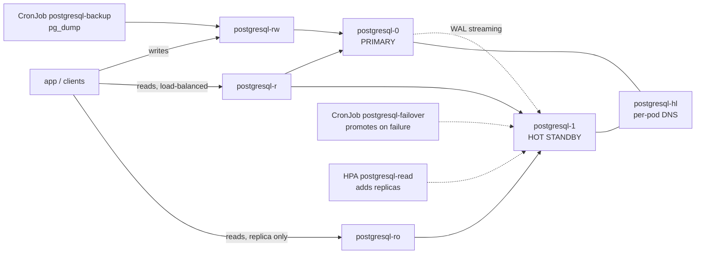

# plain-pg

PostgreSQL streaming replication on OpenShift with plain Kubernetes objects: no
operator, no CRDs, no console. A two-pod StatefulSet where the `postgresql-role`
ConfigMap decides which pod is primary, so a failover is changing a value and
recreating pods.



`postgresql-rw` carries writes to the primary. `postgresql-r` spreads reads over
**every** Ready instance (so it scales when the read HPA adds replicas).
`postgresql-ro` sends reads to a single replica, to keep them off the primary.
`postgresql-hl` is headless DNS, used by replication.

## Why it exists

One PostgreSQL server is a single point of failure with one server's worth of
reads. PostgreSQL ships the mechanism to fix that — **streaming replication**, in
which the primary streams its WAL to a hot standby that stays online and answers
read-only queries. What it does *not* do is decide when to promote the standby,
keep the replication config current, or repoint clients; that part is the work:

| Approach | What is still on you |
|---|---|
| PostgreSQL on two hosts, wired by hand | create the standby, keep `primary_conninfo` current, promote on failure, re-seed the old primary when it returns, repoint clients |
| PostgreSQL on Kubernetes | pods restart and reschedule, but it does not configure replication, pick the primary, or repoint the Services |
| A dedicated HA stack (CloudNativePG, Crunchy PGO, Patroni) | more automation, but another distributed system or CRD stack to run |

This project is the middle path: PostgreSQL's own replication on plain Kubernetes
objects. A ConfigMap holds the role, the entrypoint configures each pod for it (no
per-server setup), reads scale through `postgresql-r`, and failover is a script —
not an operator.

## How the primary is chosen

`postgresql-0` is primary by convention, not by code. On startup each pod reads
`PRIMARY_POD` and, if it matches its own name, starts as primary; otherwise it
starts as a replica of the named pod. There is no leader election: the role is an
explicit value you change on purpose.

The entrypoint also brings `PGDATA` to the assigned role:

| desired | `PGDATA` holds | action |
|---|---|---|
| primary | empty | `initdb` + user creation (done by the image) |
| primary | standby | delete `standby.signal` → promote |
| replica | empty | `pg_basebackup` from the primary |
| replica | primary | wipe and re-seed |
| replica | standby | start and refresh `primary_conninfo` |

So recovering a pod is "delete it and it fixes itself", and a failover is "change
the role and recreate the pods".

## Quick start

This is plain Kubernetes: no operator, nothing to bootstrap. Create the namespace
and the credentials Secret (never in git), then apply the overlay. The primary
runs `initdb` and the replica runs `pg_basebackup` on startup, so that is the
whole install.

```bash
git clone https://github.com/rarguello/plain-pg.git && cd plain-pg

oc apply -f manifests/base/namespace.yaml          # the plain-pg namespace
oc -n plain-pg create secret generic postgresql-credentials \
  --from-literal=POSTGRESQL_USER=app        --from-literal=POSTGRESQL_PASSWORD='<app-pw>' \
  --from-literal=POSTGRESQL_DATABASE=appdb  --from-literal=POSTGRESQL_ADMIN_PASSWORD='<admin-pw>' \
  --from-literal=POSTGRESQL_MASTER_USER=replicator --from-literal=POSTGRESQL_MASTER_PASSWORD='<repl-pw>'
oc apply -k manifests/overlays/lab

oc -n plain-pg get pods          # wait for 2/2 Ready
```

Manual failover only (no failover CronJob): apply `manifests/overlays/lab-manual`
instead.

`plain-pg` is just an example namespace: change `namespace:` in the overlay (and
`NS` for the scripts) to deploy somewhere else.

The `scripts/` are for the test suite and day-2 operations, not the install:
`deploy.sh` re-applies the overlay without reverting a failover, and
`verify-replication.sh`, `failover-manual.sh`, `backup-now.sh`, `reseed-replica.sh`
do what their names say. Tear down with `./scripts/teardown.sh` (keeps the
namespace) or `--all`. There is a `Makefile`: `make deploy`, `verify`, `lint`,
`test-quick`, `test`.

## Limits

Read this before trusting it with data that matters.

| Limit | Consequence |
|---|---|
| Fencing is pod-level, not STONITH | a node partitioned from the API server can leave two primary processes |
| Replication is asynchronous | a failover can lose the last unreplicated transactions |
| Backups are logical (`pg_dump`), no WAL archiving | no point-in-time recovery; the copies live in the cluster |
| No operator, no consensus | failover is manual or a best-effort CronJob, not automatic HA |

If you need automatic failover you can trust under node partitions, or PITR, use
an operator (CloudNativePG, Crunchy, Zalando) or Patroni instead of this.

## Tests

The suite runs against a real cluster, no mocks: **23 tests, 233 checks, 0
failures** covering deploy, replication, manual and automatic failover,
persistence, backups, scaling and the HPA. See [docs/tests.md](docs/tests.md).

## Documentation

- [docs/operations.md](docs/operations.md) — deploy, verify, connect, restart, re-seed
- [docs/failover.md](docs/failover.md) — manual and automatic failover, limits
- [docs/backups.md](docs/backups.md) — backups and restore
- [docs/scaling.md](docs/scaling.md) — reads and the HPA
- [docs/tests.md](docs/tests.md) — the test suite
- [docs/evidence/](docs/evidence/) — raw output of suite runs

## Layout

```
manifests/  base + components + overlays      scripts/  deploy, failover, backup, restore, ...
tests/      suite t01..t23 + runner           tools/    static validation of embedded scripts
```

MIT. See [LICENSE](LICENSE).
