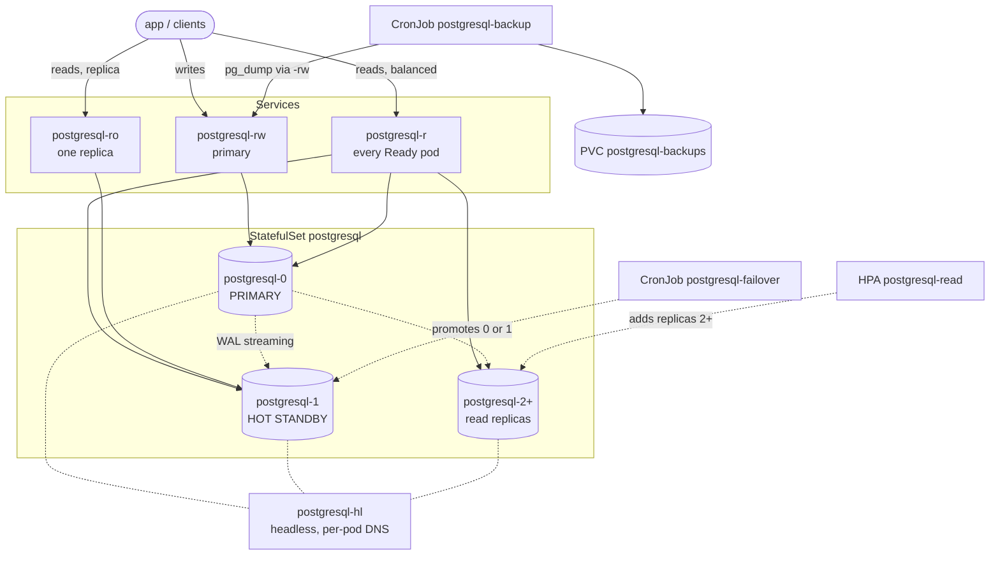

# plain-pg

PostgreSQL on OpenShift with plain objects: no operator, no CRDs, no console. One
StatefulSet and a ConfigMap that says which pod is primary.

**With or without HA.** Start with a single instance; when you want a hot
standby, scale the StatefulSet to 2 replicas and the new pod joins on its own (it
runs `pg_basebackup` at startup). That is the whole step.

| Overlay | Pods | What you get |
|---|---:|---|
| `single` | 1 | one pod, same hardening, `pg_dump` backups |
| `single-tls` | 1 | the same, serving TLS (certificate from OpenShift's service-ca) |
| `ha` | 2 | a hot standby, the `postgresql-ro` Service, automatic failover |
| `ha-manual` | 2 | a hot standby, manual failover only (no CronJob) |

The HA profile:



`postgresql-rw` carries writes to the primary. `postgresql-r` spreads reads over
every Ready pod (primary and all replicas). `postgresql-ro` pins one replica.
Replication is WAL streaming, and `postgresql-hl` gives each pod a stable DNS name
so a replica can find the primary. Each pod keeps its data on its own
`pgdata-postgresql-N` PVC.

With one replica only `postgresql-0` exists: there is no standby to stream to, no
`postgresql-ro` (nothing to pin) and nothing to promote, so `single` leaves
both out.

## Why it exists

One PostgreSQL server is a single point of failure and one server's worth of
reads. PostgreSQL ships the fix: **streaming replication**, where the primary
streams its WAL to a hot standby that answers read-only queries. What it does not
do is decide when to promote the standby, keep `primary_conninfo` current, or
repoint clients. Those steps are the work:

| Approach | Still on you |
|---|---|
| PostgreSQL on two hosts | build the standby, promote on failure, re-seed the old primary when it returns, repoint clients |
| The image in a plain StatefulSet | pods restart and reschedule, but nothing configures replication, picks the primary, or repoints the Services |
| An HA stack (CloudNativePG, Patroni, ...) | more automation, and another system to run |

This repo does those steps with PostgreSQL's own replication and plain objects: a
ConfigMap holds the role, the entrypoint configures each pod for it, reads scale
through `postgresql-r`, and failover is a script. The same objects, with one
replica, are the single-instance profile.

## How the primary is chosen

`postgresql-0` is primary by convention, not by code. On startup each pod reads
`PRIMARY_POD` and, if it matches its own name, starts as primary; otherwise it
starts as a replica of the named pod. There is no leader election: the role is an
explicit value you change on purpose.

The entrypoint also brings `PGDATA` to the assigned role:

| desired | `PGDATA` holds | action |
|---|---|---|
| primary | empty | `initdb` + user creation (done by the image) |
| primary | standby | delete `standby.signal` → promote |
| replica | empty | `pg_basebackup` from the primary |
| replica | primary | wipe and re-seed |
| replica | standby | start and refresh `primary_conninfo` |

A failover is changing the role and recreating the pods; a pod that comes back
with the wrong role re-seeds or promotes itself on startup.

## Quick start

Create the namespace and the credentials Secret (never in git), then apply a
profile. The primary runs `initdb`; every other pod runs `pg_basebackup` on
startup.

```bash
git clone https://github.com/rarguello/plain-pg.git && cd plain-pg

oc apply -f manifests/base/namespace.yaml          # the plain-pg namespace
oc -n plain-pg create secret generic postgresql-credentials \
  --from-literal=POSTGRESQL_USER=app        --from-literal=POSTGRESQL_PASSWORD='<app-pw>' \
  --from-literal=POSTGRESQL_DATABASE=appdb  --from-literal=POSTGRESQL_ADMIN_PASSWORD='<admin-pw>' \
  --from-literal=POSTGRESQL_MASTER_USER=replicator --from-literal=POSTGRESQL_MASTER_PASSWORD='<repl-pw>'

oc apply -k manifests/overlays/single          # one pod
oc -n plain-pg get pods                            # wait for 1/1 Ready

oc -n plain-pg scale sts postgresql --replicas=2   # HA: a hot standby joins
```

`oc apply -k` is for a fresh install. Re-applying it after a failover or an HPA
scale resets `PRIMARY_POD`, the `-rw`/`-ro` selectors and `spec.replicas`; on a
live cluster use `scripts/deploy.sh`, which preserves the live role, the Service
selectors and the replica count while applying everything else, or patch the
object directly.

Changing profile on a live cluster is two commands, because `oc apply` does not
delete what the new overlay no longer defines:

```bash
# from the single instance to the full HA profile
oc apply -k manifests/overlays/ha                 # 2 replicas, -ro, CronJob
# from HA down to one pod
oc apply -k manifests/overlays/single
oc -n plain-pg delete svc postgresql-ro cronjob postgresql-failover
```

`plain-pg` is only the example namespace: change `metadata.name` in
`manifests/base/namespace.yaml`, the `namespace:` field in each overlay, and `NS`
in the scripts to deploy elsewhere.

Optional add-ons (each an overlay): **metrics** for Prometheus (`ha-metrics`),
**TLS** with a service-ca certificate (`ha-tls`, `single-tls`) or your own
(`ha-tls-byo`), and **external access** through a NodePort (`ha-external`).
`ha-autoscale` adds the read HPA. See [operations.md](docs/operations.md).

The `scripts/` are for the test suite and day-2 operations, not the install:
`deploy.sh` re-applies the overlay without reverting a failover;
`verify-replication.sh`, `failover-manual.sh`, `backup-now.sh` and
`reseed-replica.sh` are the day-2 helpers. Tear down with `./scripts/teardown.sh`
(keeps the namespace) or `--all`. `make deploy|verify|lint|ci|test-quick|test`.

## Limits

Known limitations:

| Limit | Consequence |
|---|---|
| Fencing is pod-level, not STONITH | a node partitioned from the API server can leave two primary processes |
| Replication is asynchronous | a failover can lose the last unreplicated transactions |
| Backups are logical (`pg_dump`), no WAL archiving | no point-in-time recovery; the copies live in the cluster |
| No operator, no consensus | failover is manual or a best-effort CronJob, not automatic HA |
| The single-instance profile | a restart, an upgrade or a node failure is downtime |

## Tests

The suite runs against a real cluster, no mocks: **32 tests, 317 checks, 0
failures** covering deploy, the single-instance profile and the step to HA,
replication, manual and automatic failover, persistence, backups, disaster
recovery, scaling, the HPA, metrics, TLS and external access. See
[docs/tests.md](docs/tests.md).

CI runs it too: on every push it lints, validates the manifests (Kubernetes
schema + the AGENTS.md rules) and scans for secrets; **every night it creates a
throwaway MicroShift cluster inside the runner** (MINC) and runs the suite
against it, uploading the transcript.

## Documentation

- [docs/operations.md](docs/operations.md) — deploy, the single-instance profile, verify, connect, metrics, TLS
- [docs/failover.md](docs/failover.md) — manual and automatic failover, limits
- [docs/backups.md](docs/backups.md) — backups and restore
- [docs/scaling.md](docs/scaling.md) — reads and the HPA
- [docs/tests.md](docs/tests.md) — the test suite
- [docs/image-matrix.md](docs/image-matrix.md) — which platforms/versions exist and what was probed (investigation)
- [docs/evidence/README.md](docs/evidence/README.md) — raw output of suite runs

## Layout

```
manifests/  base + components + overlays      scripts/  deploy, failover, backup, restore, ...
tests/      suite t01..t32 + runner           tools/    static validation of embedded scripts
```

MIT. See [LICENSE](LICENSE).
